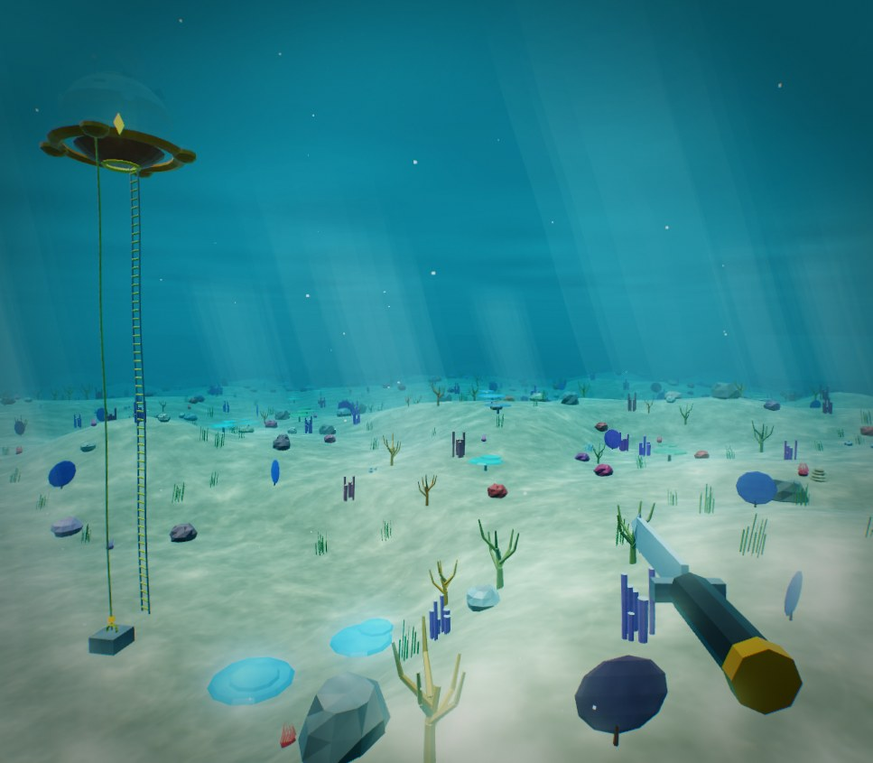
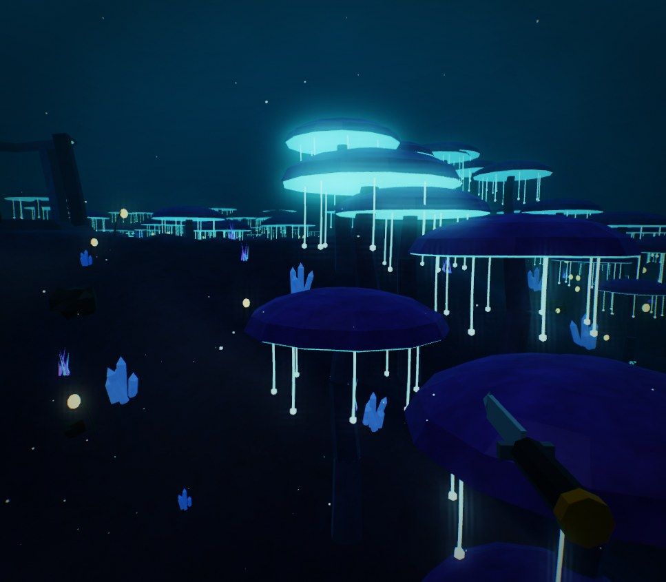
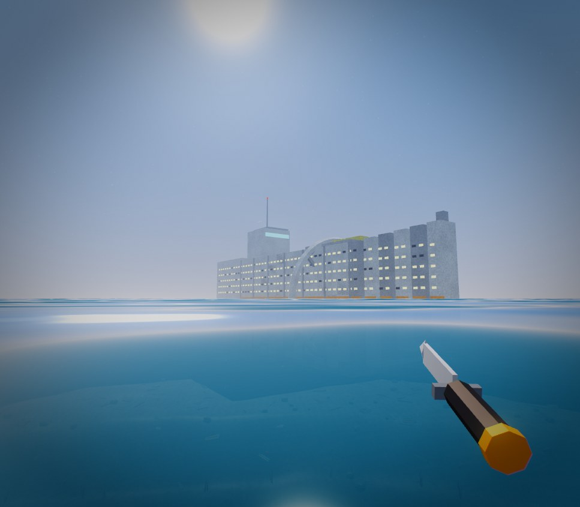
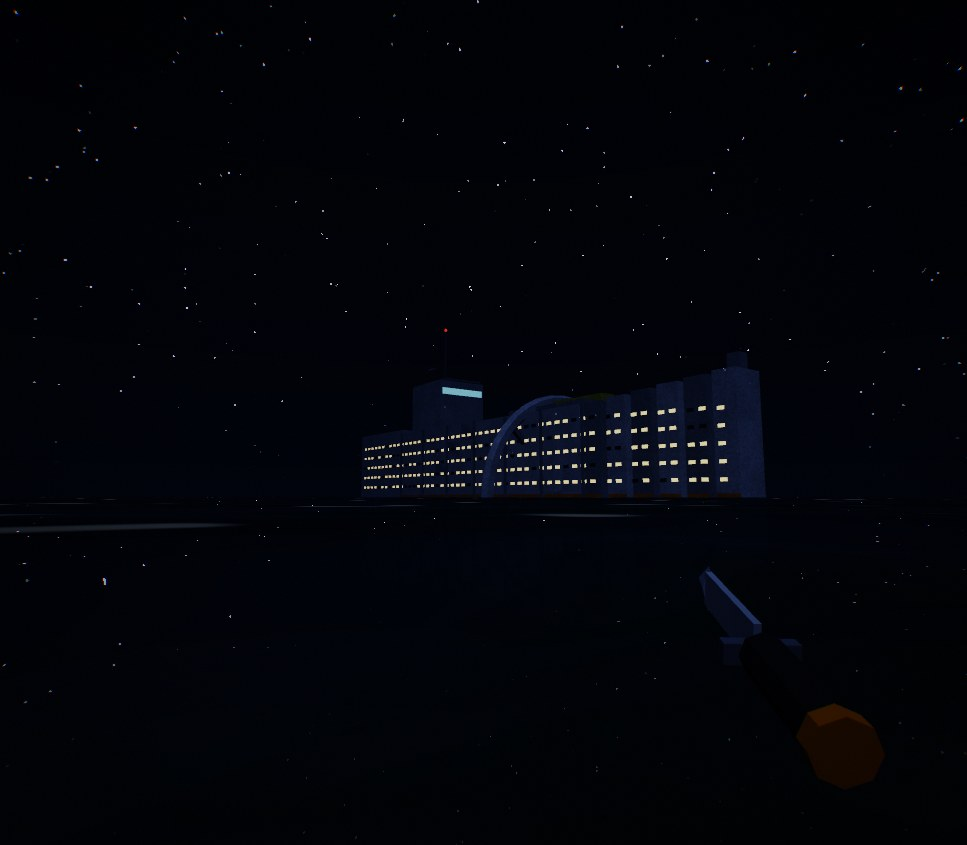

# DIVE DEEPER

**A VR survival adventure on the ocean world Nerathis-9.** Crash-land in an escape pod, explore a 2.7 km alien ocean, craft tools and vehicles, survive hostile wildlife, and find a way off-world. Plays in any modern browser with keyboard and mouse, or in **VR on Meta Quest** with Gorilla Tag–style arm movement.

The whole game is a single file, `index.html`. There's nothing to install or build.



| | |
|---|---|
|  |  |
|  | |

## Features

- **Big procedural ocean**: 9 biomes (Sunlit Reef, Vinewood Forest, Crimson Grasslands, Wreckfall Expanse, Glowing Grand Reef, Golden Dunes, Abyssal Grand Reef, Scarlet Vine Trench and Furnace Abyss), streamed in chunks.
- **Living wildlife**:
  - Some fish live everywhere, others only in one or two biomes.
  - Once a hostile creature spots you, it hunts you across biome borders until you outrun it or reach shelter: your pod, a habitat or a vehicle.
  - Leviathans ignore vehicles and only give up at the pod or a base.
- **Day and night cycle**: each day lasts 15 minutes. The sun rises and sets, nights are dark and starry, and the light underwater dims after dark.
- **The Odyssey-7**: your colony ship is aground and towers out of the sea. Its reactor melts down after **3 days**. After the explosion its side is torn open and the water around it is radioactive. Bring a **Radiation Suit** to explore the flooded cargo hold and loot its supply lockers.
- **Graphics**: custom WebGL2 renderer with moving light on the sea floor, sunbeams, a reflective and refracting water surface, glow (bloom) and color grading.
- **Survival and crafting**: oxygen, food, water, a PDA, a fabricator, base building, the Manta Scout sub, the Titan exosuit and a rocket ending.
- **Multiplayer**: create or join a room with a code from the lobby computer.
- **Modes**: Survival and Creative.

## Play

### Online (recommended)

Publish it with **GitHub Pages** (steps below), then open the page link. On a Meta Quest, open the same link in the Quest Browser and press **Enter VR**.

### Locally

Download `index.html` and double-click it to open it in Edge, Chrome or Firefox.

> VR needs the page to be served over **https**, which GitHub Pages does for you. Opening the file straight from your computer works for keyboard and mouse play.

## Controls

**Desktop**

| Key | Action |
|---|---|
| Click / right-drag / arrow keys | Look |
| W A S D | Swim / walk |
| Space / C | Up / down |
| Shift | Sprint |
| Left mouse (hold) | Use tool |
| 1–8, Q, mouse wheel | Choose a tool |
| E | Interact / enter a vehicle |
| Tab | PDA (inventory, crafting, databank) |
| F | Helmet lamp |
| G | Turn the glow and screen effects on or off (for slower PCs) |
| R | Rotate a building piece while placing it |
| Esc / right mouse | Cancel |

**Meta Quest (VR)**: no joystick. Slap the ground or walls with your hands and push off to move, and pull strokes to swim. Punch resources to break them. Right stick turns, the right trigger uses a tool, A and B switch tools, X opens the PDA, Y interacts, and clicking the left stick toggles the lamp.

## Put it on GitHub

1. Create a new repository on GitHub, for example `dive-deeper`.
2. Click **Add file → Upload files** and drag in everything in this folder: `index.html`, `README.md` and the `screenshots` folder. Then click **Commit changes**.
3. Go to **Settings → Pages**. Under **Build and deployment**, set **Source** to *Deploy from a branch*, choose the `main` branch and the `/ (root)` folder, then click **Save**.
4. After a minute your game is live at `https://<your-username>.github.io/dive-deeper/`.

If you use git instead of the website:

```bash
git init
git add .
git commit -m "Dive Deeper"
git branch -M main
git remote add origin https://github.com/<your-username>/dive-deeper.git
git push -u origin main
```

## Notes

- Progress saves automatically in your browser's local storage.
- Multiplayer loads the PeerJS library from a CDN, so it needs an internet connection.
- There is no license file yet. If you want others to be able to reuse the code, add one (GitHub suggests common licenses when you click **Add file → Create new file** and name it `LICENSE`).
